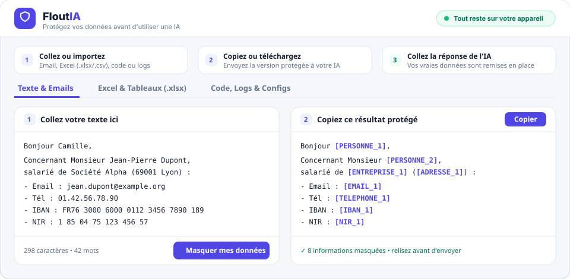
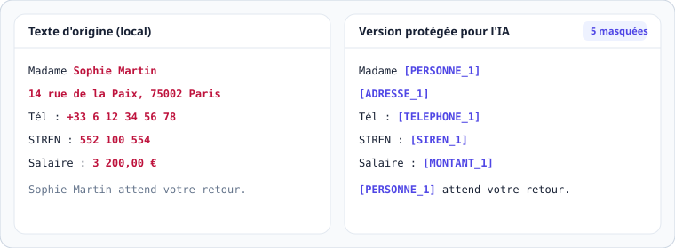
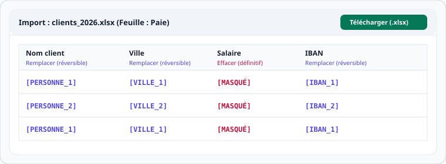
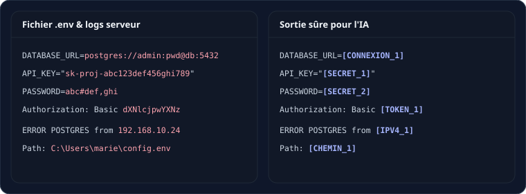
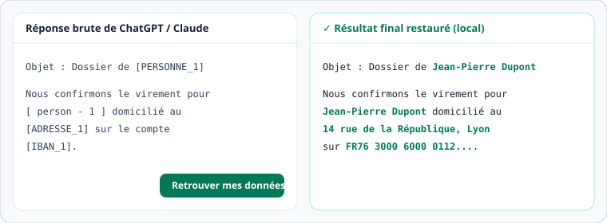

<div align="center">


# FloutIA

**Utilisez ChatGPT, Claude, Gemini ou Mistral sans jamais leur confier vos données sensibles.**

*100 % local dans votre navigateur • Zéro serveur • Zéro requête réseau • Sans inscription*

<br />


-4f46e5?style=for-the-badge)


<br />

[**Utiliser FloutIA en ligne**](https://floutia.fr) · [**Politique de sécurité**](SECURITY.md) · [**Signaler un bug**](mailto:contact@floutia.fr)

<br />



</div>

---

## Le problème

Chaque jour, des milliers de salariés, indépendants et développeurs collent dans des IA :
- des **emails et contrats** avec noms de clients, adresses et RIB,
- des **tableaux Excel** contenant des salaires ou des données personnelles,
- des **logs d’erreurs ou fichiers `.env`** avec des clés API et mots de passe.

Une fois envoyées, ces données quittent votre contrôle.

## La solution : un sas aller-retour 100 % local

1. **Collez ou importez** votre texte, votre fichier Excel (`.xlsx` / `.csv`) ou vos logs.
2. **FloutIA masque automatiquement** les données sensibles par des étiquettes (`[PERSONNE_1]`, `[IBAN_1]`) ou des noms fictifs.
3. **Envoyez** la version protégée à votre IA (ou téléchargez le `.xlsx` protégé).
4. **Collez la réponse de l’IA** : FloutIA remet exactement vos vraies données en place.

> [!TIP]
> **Astuce :** si un prénom ou nom isolé (sans *M.* / *Mme*) n'a pas été repéré, sélectionnez-le simplement à la souris puis cliquez sur **« Masquer la sélection »** pour le remplacer partout dans le texte.

---

## Captures d’écran

<table>
  <tr>
    <td width="50%" align="center">
      <strong>1. Texte, Emails &amp; Contrats</strong><br /><br />
      
      <br /><sub>Détection automatique avec surlignage et copie en 1 clic.</sub>
    </td>
    <td width="50%" align="center">
      <strong>2. Excel (.xlsx multi-feuilles &amp; CSV)</strong><br /><br />
      
      <br /><sub>Choix par colonne (Conserver / Remplacer / Effacer) et export <code>.xlsx</code>.</sub>
    </td>
  </tr>
  <tr>
    <td width="50%" align="center">
      <strong>3. Code, Logs &amp; Configs</strong><br /><br />
      
      <br /><sub>Neutralise clés API, JWT, IP et chemins tout en laissant le code lisible.</sub>
    </td>
    <td width="50%" align="center">
      <strong>4. Réinjection des vraies données</strong><br /><br />
      
      <br /><sub>Restaure vos données d'origine même si l'IA reformate les balises.</sub>
    </td>
  </tr>
</table>

---

## Données protégées automatiquement

| Catégorie | Éléments détectés | Précisions |
| :--- | :--- | :--- |
| **Identité & Contact** | Emails, téléphones FR, civilités (`M.`, `Mme`…) + noms, adresses postales | Sélection manuelle en 1 clic pour les noms isolés |
| **Banque & Administratif** | IBAN (tous pays), BIC (en contexte), NIR (clé 97), SIREN/SIRET (Luhn), montants | Validations mathématiques pour éviter les faux positifs |
| **Excel & Tableaux** | Fichiers `.xlsx` (multi-feuilles, dates), `.csv`, `.tsv`, copier-coller Excel | Export direct en `.xlsx` protégé |
| **Code, Logs & Configs** | Clés API (`sk-...`, `ghp_...`, `AKIA...`), JWT, Bearer/Basic, `.env`, IPv4/IPv6, chemins, clés PEM | Préserve les noms de variables, mots-clés SQL et URLs publiques |

---

## Sécurité & Vérification

FloutIA fonctionne **intégralement dans votre navigateur**, sans backend ni cookie ni script tiers.

- **CSP stricte embarquée :** `connect-src 'none'` bloque techniquement toute requête `fetch`, XHR ou WebSocket.
- **Zéro persistance par défaut :** textes et correspondances vivent uniquement en mémoire vive (effacés au rechargement).
- **32 tests unitaires intégrés :** exécutables en 1 clic depuis *« Comment vérifier ? »*.

**Comment vérifier vous-même :**
1. Ouvrez `https://floutia.fr` et appuyez sur `F12` (onglet **Réseau**).
2. Masquez un texte ou un fichier `.xlsx`, puis restaurez-le : **0 requête sortante** n'apparaît.
3. Coupez votre Wi-Fi : l'application continue de fonctionner normalement.

---

## Utilisation hors-ligne (sur votre ordinateur)

Pour les environnements les plus sensibles, téléchargez simplement [`index.html`](index.html) et ouvrez-le directement dans votre navigateur sans connexion Internet.

---

## Limites connues

<details>
<summary>Lire les limites techniques et juridiques</summary>

- **Pseudonymisation, pas anonymisation RGPD :** le remplacement est réversible pendant la session afin de restaurer la réponse de l'IA.
- **Détection heuristique :** relisez toujours le résultat protégé avant de l'envoyer à une IA tierce.
- **Noms fictifs :** si l'IA abrège un nom (*« Camille »* pour *« Camille Laurent »*), la restauration automatique n'est pas garantie. Préférez le mode **Étiquettes** (par défaut).
- **Limites techniques :** 500 000 caractères par zone de texte, 15 Mo / 200 colonnes / 250 000 cellules pour Excel (`.xls` binaire 97-2003 et `.xlsx` chiffrés par mot de passe non pris en charge).

</details>

---

## Structure du dépôt

```text
floutia/
├── index.html          # Application complète autonome (HTML + CSS + JS)
├── _headers            # En-têtes de sécurité serveur (Cloudflare Pages)
├── README.md           # Présentation du projet
├── SECURITY.md         # Politique de signalement des vulnérabilités
├── assets/
│   └── logo.svg        # Logo vectoriel FloutIA
└── screenshots/        # Captures d'écran du README
