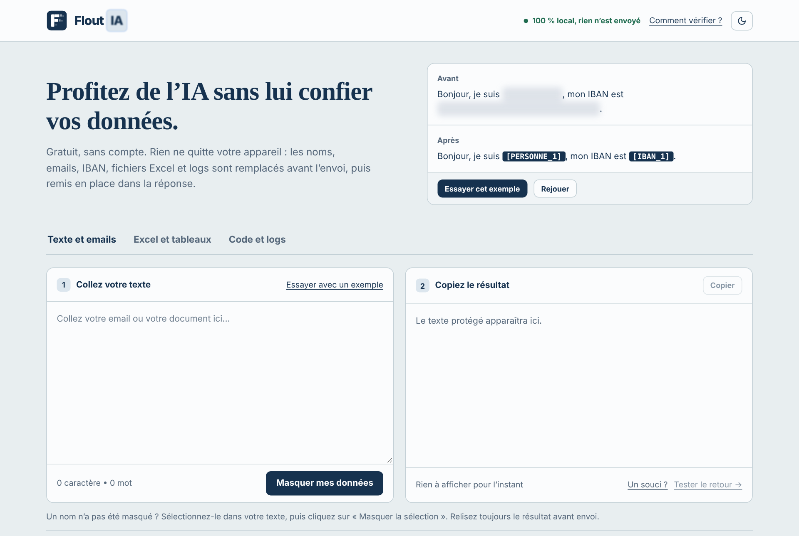
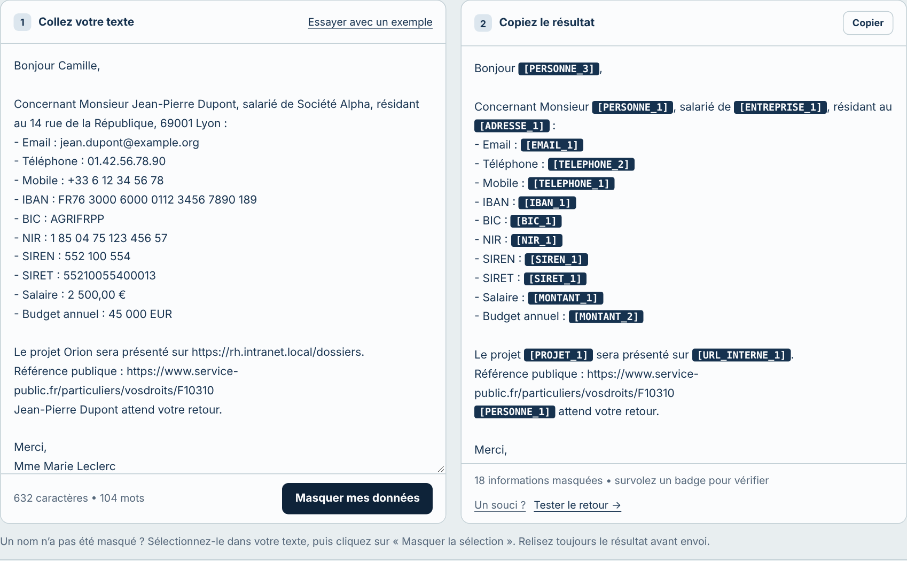
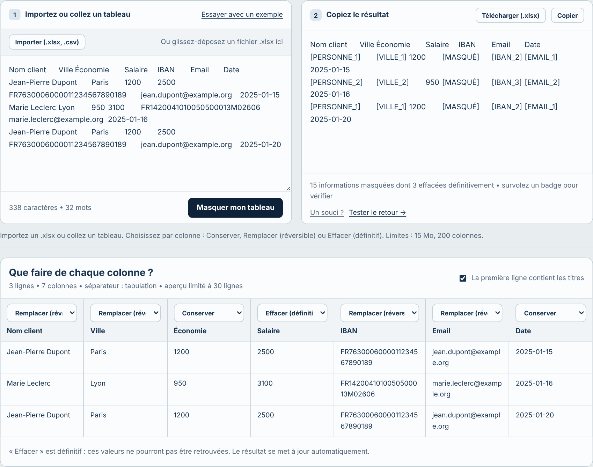
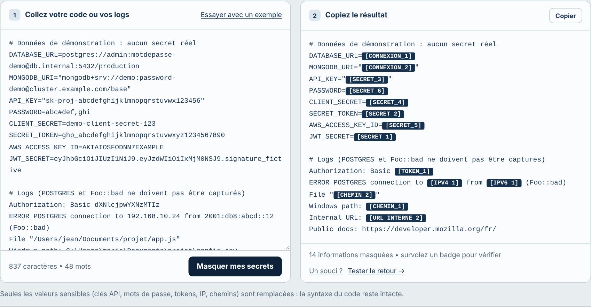
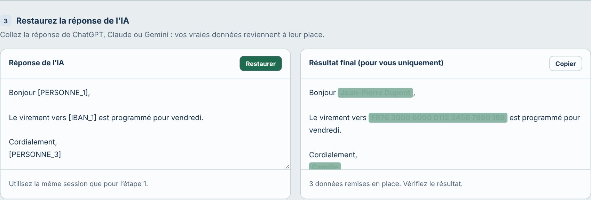

# FloutIA

**Utilisez ChatGPT, Claude, Gemini ou Mistral sans leur confier vos données sensibles.**

*100 % local dans votre navigateur • Zéro serveur • Sans inscription • Version 1.1.0*

 

-16324F?style=for-the-badge)

 

[**Utiliser FloutIA en ligne**](https://floutia.fr) · [**Politique de sécurité**](SECURITY.md) · [**Changelog**](CHANGELOG.md) · [**Signaler un bug**](https://tally.so/r/M1E0Bl)

---

## Le problème

Chaque jour, des salariés, indépendants et développeurs collent dans des IA :

- des **emails et contrats** avec noms de clients, adresses et RIB ;
- des **tableaux Excel** contenant des salaires ou des données personnelles ;
- des **logs d’erreurs ou fichiers `.env`** avec des clés API et mots de passe.

Une fois envoyées, ces données échappent à votre contrôle.

## La solution : un aller-retour 100 % local

1. **Collez ou importez** votre texte, votre fichier Excel (`.xlsx` / `.csv`) ou vos logs.
2. **FloutIA masque automatiquement** les données sensibles par des étiquettes (`[PERSONNE_1]`, `[IBAN_1]`) ou des noms fictifs.
3. **Envoyez** la version protégée à votre IA, ou téléchargez le `.xlsx` protégé.
4. **Collez la réponse de l’IA** : FloutIA remet vos vraies données en place.

> [!TIP]
> Si un prénom ou un nom isolé (sans *M.* ou *Mme*) n’a pas été repéré, sélectionnez-le à la souris puis cliquez sur **« Masquer la sélection »** : il est remplacé partout dans le texte.

---

## Aperçu

  

---

## Captures d’écran

<table>
  <tr>
    <td width="50%" align="center">
      <strong>1. Texte, emails &amp; contrats</strong>  
      
       Détection automatique et copie en un clic.
    </td>
    <td width="50%" align="center">
      <strong>2. Excel (.xlsx multi-feuilles &amp; CSV)</strong>  
      
       Choix par colonne (Conserver / Remplacer / Effacer) et export <code>.xlsx</code>.
    </td>
  </tr>
  <tr>
    <td width="50%" align="center">
      <strong>3. Code, logs &amp; configs</strong>  
      
       Neutralise clés API, JWT, IP et chemins, et laisse le code lisible.
    </td>
    <td width="50%" align="center">
      <strong>4. Réinjection des vraies données</strong>  
      
       Restaure les données d’origine, même si l’IA reformate les balises.
    </td>
  </tr>
</table>

---

## Données protégées automatiquement

| Catégorie | Éléments détectés | Précisions |
| :--- | :--- | :--- |
| **Identité & contact** | Emails, téléphones FR, noms précédés d’une civilité (`M.`, `Mme`…), adresses postales | Sélection manuelle pour les noms isolés |
| **Banque & administratif** | IBAN, BIC (en contexte), NIR (clé 97), SIREN et SIRET (Luhn), montants | Contrôles mathématiques pour limiter les faux positifs |
| **Excel & tableaux** | `.xlsx` multi-feuilles, `.csv`, `.tsv`, copier-coller depuis Excel | Choix par colonne, export `.xlsx` protégé |
| **Code, logs & configs** | Clés API (`sk-…`, `ghp_…`, `AKIA…`, `AIza…`, `xox…`), JWT, Bearer / Basic, URI de bases de données, `.env`, IPv4 / IPv6, chemins, clés PEM et OpenSSH | Conserve les noms de variables, les mots-clés SQL et les URL publiques |

---

## Sécurité & vérification

FloutIA fonctionne **dans votre navigateur**, sans serveur de traitement, sans cookie et sans script tiers.

- **CSP stricte embarquée :** `connect-src 'none'` empêche techniquement toute requête `fetch`, XHR ou WebSocket depuis l’outil.
- **Pas de persistance par défaut :** les textes et correspondances vivent en mémoire vive et disparaissent au rechargement. Seul le thème, et la liste de mots si vous la sauvegardez, sont conservés localement.
- **33 tests unitaires intégrés**, exécutables en un clic depuis *« Comment vérifier ? »*.

**Comment vérifier vous-même :**

1. Ouvrez `https://floutia.fr`, puis `F12` et l’onglet **Réseau**.
2. Masquez un texte ou un fichier `.xlsx`, puis restaurez-le : **aucune requête sortante** n’apparaît.
3. Coupez le Wi-Fi : l’outil continue de fonctionner.

> [!NOTE]
> Le seul lien sortant est le formulaire de retour (Tally), ouvert à votre initiative dans un nouvel onglet. Il ne transmet aucun contenu de l’outil.

---

## Utilisation hors ligne

Téléchargez [`index.html`](index.html) et ouvrez-le dans votre navigateur, sans connexion Internet.

---

## Pages de contenu

Le site publie aussi des pages par cas d’usage, pour les moteurs de recherche :

- [`anonymiser-excel-chatgpt`](https://floutia.fr/anonymiser-excel-chatgpt) : Excel et CSV avant une IA ;
- [`masquer-cles-api-logs`](https://floutia.fr/masquer-cles-api-logs) : clés API, `.env` et logs ;
- [`pseudonymiser-donnees-rgpd`](https://floutia.fr/pseudonymiser-donnees-rgpd) : pseudonymisation et RGPD.

---

## Limites connues

Lire les limites techniques et juridiques

- **Pseudonymisation, pas anonymisation au sens du RGPD :** le remplacement est réversible pendant la session, pour restaurer la réponse de l’IA. Ce n’est ni une certification RGPD ni une garantie d’anonymat.
- **Détection heuristique :** relisez toujours le résultat protégé avant envoi à une IA tierce.
- **Noms fictifs :** si l’IA abrège un nom (« Camille » pour « Camille Laurent »), la restauration automatique n’est pas garantie. Préférez le mode **Étiquettes**, par défaut.
- **Limites :** 500 000 caractères par zone de texte ; pour Excel, 15 Mo, 200 colonnes et 250 000 cellules. Les fichiers `.xls` (Excel 97-2003) et les `.xlsx` chiffrés par mot de passe ne sont pas pris en charge.

---

## Structure du dépôt

    floutia/
    ├── index.html                        # Application complète autonome (HTML + CSS + JS)
    ├── anonymiser-excel-chatgpt.html     # Page de contenu : Excel et IA
    ├── masquer-cles-api-logs.html        # Page de contenu : clés API et logs
    ├── pseudonymiser-donnees-rgpd.html   # Page de contenu : RGPD
    ├── favicon.svg / .png / .ico         # Icônes de l’onglet
    ├── _headers                          # En-têtes de sécurité (Cloudflare Pages)
    ├── CHANGELOG.md                      # Historique des versions
    ├── README.md                         # Présentation du projet
    ├── SECURITY.md                       # Politique de signalement des vulnérabilités
    ├── assets/
    │   └── logo.svg                      # Logo vectoriel
    └── screenshots/                      # Captures d’écran du README (PNG)

---

## Licence & contact

© 2026 **FloutIA**. Tous droits réservés.
Conçu en France • Hébergé sur Cloudflare Pages • Contact : **contact@floutia.fr**
